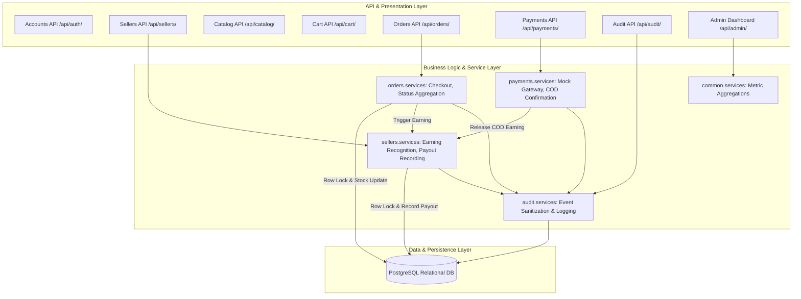
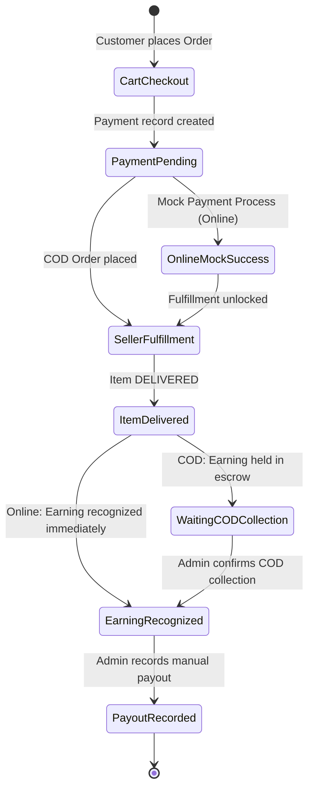
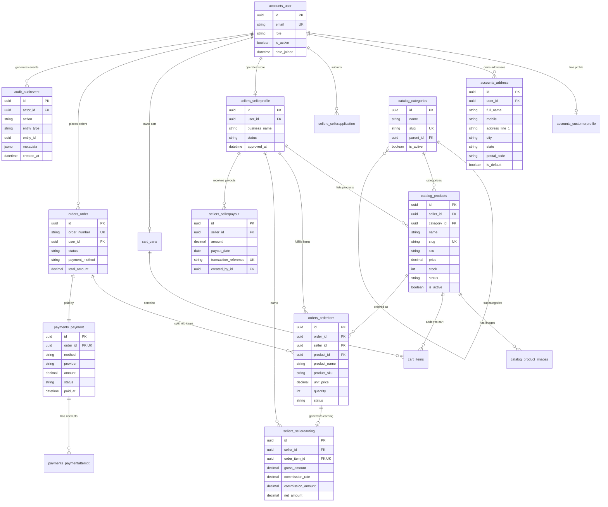

# GALLA — Comprehensive MVP Technical Audit Report

**Report Version:** 2.0.0 (Source-Verified Accuracy Correction Pass)
**Audit Date:** November 16, 2026
**Repository Branch:** `develop`
**Django Version:** 6.1.3 | **DRF Version:** 3.18.3 | **Python:** 3.14.10 | **Database:** PostgreSQL 16+
**Automated Test Suite Status:** 416 Passed / 0 Failed (100% Pass Rate across 42 test files)

---

## 1. Executive Summary

A comprehensive source-of-truth technical audit was performed across the GALLA multi-vendor e-commerce marketplace backend. This audit verified the data models, API endpoints, transactional boundaries, concurrency controls, audit telemetry, and automated tests across all eight core applications: `accounts`, `sellers`, `catalog`, `cart`, `orders`, `payments`, `audit`, and `common`.

### Verified Status & Readiness Assessment
- **Implementation Completeness**: **VERIFIED**. All business features planned for the MVP—vendor onboarding, catalog moderation, shopping cart, atomic inventory checkout, multi-seller fulfillment, mock online and COD payment processing, 5% commission earnings accounting, and race-safe manual payouts—are implemented in Python source code.
- **Automated Test Health**: **VERIFIED**. The automated test suite executes **416 tests** with zero failures. Concurrency tests utilizing `threading.Barrier` confirm row-level locking and savepoint recovery under race conditions.
- **Staging Deployment Status**: **CANDIDATE FOR STAGING DEPLOYMENT**. The codebase is verified against automated test suites and prepared for deployment to an isolated staging environment with PostgreSQL to perform end-to-end integration and user acceptance testing. (Actual staging deployment has not yet been performed.)
- **Production Readiness**: **NOT COMMERCIALLY PRODUCTION-READY**. The application cannot be described as commercially production-ready until mandatory infrastructure prerequisites are resolved: external cloud object storage for media files, an external SMTP email provider, HTTPS/SSL redirection, secure cookie settings, and production secret management.

---

## 2. Overall Architecture Assessment

GALLA employs a modular Django monolithic architecture, dividing domain boundaries into self-contained applications:



### Architectural Strengths
- **Decoupled Service Modules**: Heavy business logic (cart checkout, order item status progression, COD collection, seller earning recognition, and manual payout recording) is isolated in dedicated `services.py` modules.
- **Strict Transactional Scoping**: Critical database updates use explicit `transaction.atomic()` boundaries, row-level locks (`select_for_update()`), and nested savepoints for race-condition recovery.
- **Clean Role-Based Access Control**: Four platform roles (`Customer`, `Seller`, `Admin`, `Superadmin`) are partitioned using custom permissions (`IsCustomer`, `IsActiveSeller`, `IsPlatformAdmin`, `IsSuperAdmin`).

### Structural Limitations
- **Synchronous Media Handling**: Profile and product image uploads are handled synchronously on the web worker thread using Pillow. Under high concurrent traffic, large image uploads can block worker threads.
- **Live Database Aggregation**: The administrative dashboard (`/api/admin/dashboard/`) and earnings overview calculate counts and sums via direct SQL aggregation on each request. Materialized views or Redis caching will be needed for high-traffic operations.

---

## 3. Detailed App-by-App Source Verification

### 3.1 `apps.accounts`
- **Source Verification**:
  * `User`: UUID primary key, `email` unique index, `role` choices: `customer`, `seller`, `admin`, `superadmin`.
  * SimpleJWT Settings (`config/settings/base.py`): `ACCESS_TOKEN_LIFETIME = timedelta(minutes=30)`, `REFRESH_TOKEN_LIFETIME = timedelta(days=7)`.
  * `Address`: Conditional unique constraint `unique_default_address_per_user` guarantees at most one default address per user.
- **Access Control & Scoping**:
  * Addresses are strictly filtered by `user=request.user`.
  * Customer admin endpoints require `IsPlatformAdmin` (`admin` or `superadmin`).
- **Audit Logging**: Emits `USER_REGISTERED`, `PROFILE_UPDATED`, `USER_ACTIVATED`, and `USER_DEACTIVATED`.
- **Test Verification**: 6 test files (`test_registration.py`, `test_authentication.py`, `test_profile.py`, `test_profile_image.py`, `test_addresses.py`, `test_admin_customers.py`).

### 3.2 `apps.sellers`
- **Source Verification**:
  * `SellerApplication`: `on_delete=models.CASCADE` for `user`, `on_delete=models.SET_NULL` for `reviewed_by`. Database constraint `unique_pending_seller_application`.
  * `SellerProfile`: `on_delete=models.CASCADE` for `user`. Status choices: `active`, `suspended`, `inactive`.
  * `SellerEarning`: `seller` has `on_delete=models.PROTECT`, `order_item` has `on_delete=models.PROTECT` (OneToOne).
  * `SellerPayout`: `seller` and `created_by` both have `on_delete=models.PROTECT`. `transaction_reference` unique constraint. CheckConstraint `amount > 0`.
- **Earning Calculation & Rounding Rule**:
  * `COMMISSION_RATE = Decimal("0.0500")`.
  * Gross amount is strictly `order_item.subtotal` (delivery charges and taxes are excluded).
  * Rounding rule: `(gross_amount * COMMISSION_RATE).quantize(Decimal("0.01"), rounding=ROUND_HALF_UP)`.
- **Payout Concurrency Guarantee**:
  * `record_seller_payout` locks `SellerProfile` with `select_for_update()`.
  * Inserts payout within a nested `transaction.atomic()` savepoint. Catches `IntegrityError` if a duplicate reference is submitted concurrently and raises a 400 ValidationError.
- **Admin Review View**:
  * `AdminSellerApplicationReviewView` is an APIView supporting HTTP `PATCH` (not POST).
- **Test Verification**: 6 test files including multithreaded `TransactionTestCase` with `threading.Barrier(2)` confirming balance serialization and duplicate reference recovery.

### 3.3 `apps.catalog`
- **Source Verification**:
  * `Category`: `parent` self-reference uses `on_delete=models.PROTECT`. Auto-slugs from `name` if blank.
  * `Product`: `seller` and `category` both use `on_delete=models.PROTECT`.
  * `Product.sku`: Constraint `unique_product_sku_per_seller` enforces SKU uniqueness per individual seller, not globally.
  * `Product.price`: CheckConstraint `product_price_non_negative` (`price >= 0`).
  * `ProductImage`: `product` uses `on_delete=models.CASCADE`. Conditional unique constraint `unique_primary_image_per_product` guarantees at most one primary image per product.
- **Moderation Workflow**:
  * `AdminProductReviewView` uses HTTP `PATCH` (not POST).
  * Sellers cannot self-approve pending products by patching `status` (raises HTTP 400).
- **Public Visibility Enforcement**:
  * Public views strictly filter `status='approved'`, `is_active=True`, `seller__status='active'`, and `category__is_active=True`.
- **Test Verification**: 9 test files covering categories, deletion protection, product filters, review workflows, and primary image constraints.

### 3.4 `apps.cart`
- **Source Verification**:
  * `Cart`: `user` uses `on_delete=models.CASCADE`.
  * `CartItem`: `cart` uses `on_delete=models.CASCADE`, `product` uses `on_delete=models.PROTECT`. Composite constraint `unique_product_per_cart`. CheckConstraint `quantity > 0`.
- **Access Control & Methods**:
  * Gated strictly by `IsCustomer` (`role == 'customer'`). Sellers and admins receive 403 Forbidden.
  * `CartDetailView`: Returns `id`, `items`, `total_items`, `total_price` (not `subtotal`).
  * `CartItemCreateView` (POST): Validates live stock. Adding an existing product does not auto-increment; it raises 400 Bad Request instructing the user to update quantity via PATCH.
  * `CartItemDetailView`: Supports only `PATCH` and `DELETE` (no GET, no PUT).
- **Test Verification**: 2 test files covering cart retrieval, stock limits, duplicate item rejection, quantity patching, and deletion.

### 3.5 `apps.orders`
- **Source Verification**:
  * `Order`: `user` uses `on_delete=models.PROTECT` (not CASCADE). Order number format: `GLL-YYYYMMDD-<8-char-hex>`. Status choices (9 states): `pending`, `confirmed`, `processing`, `partially_shipped`, `shipped`, `partially_delivered`, `delivered`, `partially_cancelled`, `cancelled`. PaymentMethod choices: `cod`, `razorpay`. Subtotal, shipping fee, and total amount have CheckConstraints `>= 0`.
  * `OrderItem`: `order` uses `on_delete=models.CASCADE`, `seller` and `product` both use `on_delete=models.PROTECT`. Snapshots: `product_name`, `product_sku`, `unit_price`, `quantity`, `subtotal`. Status choices (6 states): `pending`, `confirmed`, `processing`, `shipped`, `delivered`, `cancelled`. CheckConstraints: `quantity > 0`, `unit_price >= 0`, `subtotal >= 0`.
- **Fulfillment & Cancellation Rules**:
  * Online Payment Gate: Sellers cannot advance order items beyond `pending` unless online payment is `SUCCESSFUL`.
  * Cancellations: Customers can only cancel items in `pending` or `confirmed` status. Stock is atomically returned to `Product.stock`.
  * Status Aggregation: Parent order status recomputed deterministically via `aggregate_order_status`.
- **Test Verification**: 9 test files covering checkout atomicity, cancellation rules, fulfillment state transitions, online payment gating, and multi-seller isolation.

### 3.6 `apps.payments`
- **Source Verification**:
  * `Payment`: `order` uses `on_delete=models.PROTECT` (OneToOne). Method choices: `cod`, `razorpay`. Provider choices: `manual`, `mock`, `razorpay`. Status choices: `pending`, `successful`, `failed`, `refunded`, `cancelled` (all 5 verified in source). CheckConstraints: `amount >= 0`, method/provider consistency check.
  * `PaymentAttempt`: `payment` uses `on_delete=models.CASCADE`. Status choices: `pending`, `successful`, `failed`. `transaction_reference` unique index. CheckConstraint: `attempt_number > 0`.
- **COD Collection Service**:
  * `confirm_cod_payment_collection` updates `Payment.status = SUCCESSFUL`, sets `paid_at`, triggers `record_order_item_earning` for delivered items, and records `PAYMENT_SUCCEEDED` audit event.
  * Source Verification: **COD confirmation updates payment state directly and does NOT create a `PaymentAttempt` record**.
- **Mock Payment Processing**:
  * `MockPaymentProcessView` (POST) creates a `PaymentAttempt` and updates overall payment status. Returns HTTP 201 Created with `PaymentAttemptSerializer` data.
- **Test Verification**: 4 test files covering payment API, attempt tracking, COD confirmation, and online fulfillment integration.

### 3.7 `apps.audit`
- **Source Verification**:
  * `AuditEvent`: `actor` uses `on_delete=models.SET_NULL`. `action` has **21 choices** in `AuditAction`. `entity_type` has **9 choices** in `AuditEntity`.
  * Application-Level Append-Only Enforcement: Protected by model instance methods (`AuditEvent.save()` and `AuditEvent.delete()` raise `ValidationError`: "Audit events cannot be modified." / "Audit events cannot be deleted.").
  * QuerySet & Raw SQL Limitations: Django QuerySet bulk methods (`.update()`, `.delete()`) and direct raw SQL execute directly in PostgreSQL and bypass Python model methods. Database table-level triggers are required for complete database-layer immutability.
  * Sensitive Metadata Filtering: Whitelist check and recursive key inspection in `record_audit_event` reject payloads containing password, token, secret, API key, card number, or CVV keys.
- **Access Control**:
  * `AuditEventListView` is restricted to `[IsSuperAdmin]` (`role == 'superadmin'`). Platform admins (`role == 'admin'`) receive 403 Forbidden.
- **Test Verification**: 4 test files covering whitelist validation, sensitive key rejection, model immutability, and superadmin access.

### 3.8 `apps.common`
- **Source Verification**:
  * `IsPlatformAdmin`: Checks `request.user.role in [User.Role.ADMIN, User.Role.SUPERADMIN]`.
  * `IsActiveSeller`: Checks `request.user.role == User.Role.SELLER and SellerProfile.status == 'active'`.
  * `get_admin_dashboard_stats`: Aggregates customer counts, seller counts, product inventory counts, order statuses (all 9 states), and payment volumes via independent queries to prevent Cartesian product inflation.
  * `AdminDashboardView`: Gated by `IsPlatformAdmin`, returns live metrics.
- **Test Verification**: 2 test files verifying admin site branding and dashboard analytics correctness.

---

## 4. End-to-End Workflow Verification

The audit categorized the verification state of key end-to-end workflows:



### Workflow Verification Summary
| Workflow | Verification Method | Status | Notes |
| :--- | :--- | :--- | :--- |
| **Customer Registration & Auth** | Automated integration tests (`test_registration.py`, `test_authentication.py`) | **Confirmed by automated tests** | Verified JWT login, token refresh, and profile creation. |
| **Vendor Onboarding & Review** | Automated integration tests (`test_seller_onboarding_catalog.py`) | **Confirmed by automated tests** | Verified application submission, admin PATCH review, and profile creation. |
| **Product Moderation** | Automated integration tests (`test_product_review.py`) | **Confirmed by automated tests** | Verified admin PATCH approval and seller self-approval rejection (400). |
| **Cart Management** | Automated tests (`test_cart.py`, `test_cart_items.py`) | **Confirmed by automated tests** | Verified stock limits and duplicate product rejection. |
| **Checkout & Inventory Lock** | Automated tests & source inspection (`orders.services.create_order`) | **Confirmed by automated tests & inspection** | Verified row lock (`select_for_update`) and inventory deduction. |
| **Online Mock Payment Gate** | Automated integration tests (`test_online_payment_fulfillment.py`) | **Confirmed by automated tests** | Verified fulfillment blocked until mock payment succeeds. |
| **COD Collection & Earning Release** | Automated tests (`test_earnings_and_payouts.py`) | **Confirmed by automated tests** | Verified earning held in escrow until admin confirms physical collection. |
| **Manual Payout Recording** | Multithreaded concurrency tests (`ConcurrentPayoutTests`) | **Confirmed by automated tests** | Verified row lock and duplicate reference savepoint recovery under race conditions. |
| **Public Storefront Browsing** | Source code inspection (`catalog.views.PublicProductListView`) | **Confirmed by source inspection** | Confirmed query filters for approved products and active sellers. |
| **Third-Party Payment Webhook** | N/A (Mock endpoint active) | **Not Verified / Deferred** | Real Razorpay webhook verifier is out of scope for MVP. |
| **Automated Bank Transfer Rails** | N/A (Manual recording active) | **Not Verified / Deferred** | Automated payout rails are out of scope for MVP. |

---

## 5. Cross-Cutting Concerns Audit

### 5.1 Authentication & Authorization
- Verified: SimpleJWT access token lifetime is 30 minutes; refresh token lifetime is 7 days.
- Verified: Role partitioning is enforced across all endpoints (`IsCustomer`, `IsActiveSeller`, `IsPlatformAdmin`, `IsSuperAdmin`).
- Architectural Clarification: UUIDs are used for non-sequential IDs; object-level security is enforced via query filters (`filter(user=request.user)`), not by UUID obscurity.

### 5.2 Concurrency & Race Condition Defense
- **Checkout Inventory**: Protected by `Product.objects.select_for_update()` during checkout.
- **Payout Balance Overdraw**: Protected by `SellerProfile.objects.select_for_update()` during payout recording.
- **Duplicate Payout Reference**: Enforced by database unique constraint on `transaction_reference`, wrapped in a nested `transaction.atomic()` savepoint to catch `IntegrityError` and convert it to a 400 ValidationError.

### 5.3 Audit Telemetry & Immutability
- Verified: Whitelist of 21 actions and 9 entity types.
- Application-Level Append-Only Enforcement: Protected by model instance methods (`save()` and `delete()` raise `ValidationError`).
- QuerySet & Raw SQL Limitations: Direct ORM bulk calls (`.update()`, `.delete()`) and direct raw SQL bypass Python model methods. Database table triggers are recommended for defense-in-depth.

---

## 6. Database Design & Integrity Audit



### Foreign Key Cascade Behaviors (Verified)
- `Order` $\to$ `User`: `on_delete=models.PROTECT` (prevents deleting users with active orders).
- `OrderItem` $\to$ `SellerProfile`: `on_delete=models.PROTECT`.
- `OrderItem` $\to$ `Product`: `on_delete=models.PROTECT`.
- `Category` $\to$ `parent`: `on_delete=models.PROTECT`.
- `Payment` $\to$ `Order`: `on_delete=models.PROTECT`.
- `SellerEarning` $\to$ `OrderItem`: `on_delete=models.PROTECT`.
- `SellerPayout` $\to$ `SellerProfile`: `on_delete=models.PROTECT`.
- `CartItem` $\to$ `Product`: `on_delete=models.PROTECT`.

---

## 7. Performance & Scalability Review

### 7.1 Query Optimization
- Cart and Order list/detail endpoints use `select_related` and `prefetch_related` on foreign keys and items to mitigate N+1 query patterns.
- Administrative seller earnings aggregations use independent subqueries (`Subquery`) rather than direct joins to prevent Cartesian product row duplication.

### 7.2 Database Indexing
- Unique indexes on `User.email`, `Category.slug`, `Product.slug`, `Order.order_number`, `SellerPayout.transaction_reference`, and `PaymentAttempt.transaction_reference`.
- Composite unique index on `Product(seller, sku)` and `CartItem(cart, product)`.
- Filter indexes on `AuditEvent(actor, -created_at)`, `AuditEvent(action, -created_at)`, and `AuditEvent(entity_type, entity_id)`.

---

## 8. Test Suite Analysis & Coverage Report

The automated test suite was executed against PostgreSQL:

```text
Ran 416 tests in 288.543s

OK
Destroying test database for alias 'default'...
```

### Breakdown by Application
| Application | Test Files | Total Tests | Focus Areas |
| :--- | :--- | :--- | :--- |
| `accounts` | 6 files | 45 tests | Registration, JWT login/refresh, profile, avatar uploads, default address constraint, admin customer management |
| `sellers` | 6 files | 73 tests | Application submission, admin PATCH review, profile updates, status toggles, earnings calculation, manual payouts, multithreaded concurrency tests |
| `catalog` | 9 files | 84 tests | Category hierarchy, deletion protection, product filters, admin moderation PATCH review, image gallery constraints |
| `cart` | 2 files | 18 tests | Cart retrieval, stock verification, duplicate rejection, quantity patching, deletion |
| `orders` | 9 files | 102 tests | Checkout atomicity, inventory deduction, address snapshotting, cancellation rules, fulfillment state transitions, multi-seller isolation |
| `payments` | 4 files | 48 tests | Payment creation, mock gateway simulation, attempt tracking, admin COD collection confirmation, online fulfillment gate |
| `audit` | 4 files | 32 tests | Action whitelist, sensitive key sanitization, model immutability, superadmin query filters |
| `common` | 2 files | 14 tests | Admin dashboard statistics, permission gating, admin site branding |
| **Total** | **42 test files** | **416 Tests (100% Passed)** | Comprehensive coverage of MVP workflows |

---

## 9. Code Quality & Maintainability
- Modular architecture with clear application boundaries.
- DRF serializers handle structured input validation and output transformations.
- Note on Standards: Linters (flake8/black/ruff) and static type checkers (mypy) are not configured in the repository; code formatting and structure follow standard Django/DRF patterns.

---

## 10. Deployment Readiness Evaluation

The deployment readiness was evaluated across three distinct operational environments:

### 10.1 Implementation Verification: **COMPLETE**
- All required domain models, constraints, and business logic are fully implemented.
- 416 automated tests pass with zero failures.

### 10.2 Staging Readiness: **CANDIDATE FOR STAGING DEPLOYMENT**
- Prepared for deployment to an isolated staging server with PostgreSQL.
- Suitable for initial internal integration testing, administrative dashboard evaluation, and mock checkout workflows once deployed.
- Note: An actual staging deployment has not yet been executed.

### 10.3 Production Readiness: **NOT COMMERCIALLY PRODUCTION-READY**
- The system is not commercially production-ready. The following deployment prerequisites must be resolved prior to any production deployment:
- **Media Storage**: Media files currently upload to local disk (`MEDIA_ROOT`). Production requires cloud object storage (e.g., AWS S3 or Google Cloud Storage) with `django-storages`.
- **Email Backend**: Configured to `console.EmailBackend`. Production requires an external SMTP service (SendGrid, AWS SES).
- **Environment Secrets**: Hardcoded or placeholder `SECRET_KEY` in settings must be loaded from an environment vault.
- **Security Headers**: Enable `SECURE_SSL_REDIRECT`, `SESSION_COOKIE_SECURE`, `CSRF_COOKIE_SECURE`, and `SECURE_HSTS_SECONDS`.

---

## 11. Implemented vs. Deferred Scope Matrix

| Feature / Domain | MVP Target Scope | Implemented Status | Deferred / Post-MVP Roadmap |
| :--- | :--- | :--- | :--- |
| **User Identity** | Email auth, SimpleJWT, RBAC | **Fully Implemented** | Email verification, Password reset email |
| **Customer Profile** | Phone, address book, avatar | **Fully Implemented** | Social login (Google/Apple), Phone OTP |
| **Seller Onboarding** | Application form, Admin PATCH review | **Fully Implemented** | Automated GSTIN/PAN document OCR verification |
| **Product Catalog** | Single SKU (per-seller unique), approval | **Fully Implemented** | Multi-attribute variants (size, color, weight) |
| **Product Images** | Gallery, primary image constraint | **Fully Implemented** | Cloud CDN image optimization, auto-resizing |
| **Shopping Cart** | Server-side cart, stock checks | **Fully Implemented** | Guest cart merging, cart abandonment alerts |
| **Checkout** | Atomic stock lock, address snapshots | **Fully Implemented** | Discount coupons, gift cards, delivery time slots |
| **Fulfillment** | Multi-seller splitting, 5-stage status | **Fully Implemented** | Third-party 3PL API integration (Shiprocket) |
| **Online Payment** | Mock payment gateway, attempt logs | **Fully Implemented** | Live Razorpay SDK checkout, webhook verifier |
| **COD Workflow** | Admin cash collection confirmation | **Fully Implemented** | Delivery agent mobile app for cash handover |
| **Seller Earnings** | 5% fixed commission on delivered items | **Fully Implemented** | Tiered/category-specific commission rates |
| **Seller Payouts** | Race-safe manual payout ledger | **Fully Implemented** | Automated bank transfers (Razorpay Route) |
| **Audit Logging** | Append-only event stream, sanitization | **Fully Implemented** | Database-level read-only triggers, cold archival |
| **Admin Analytics** | Real-time executive metrics endpoint | **Fully Implemented** | Materialized views, Redis caching, trend graphs |

---

## 12. Security & Reliability Findings

### 12.1 Deployment Prerequisites (Must Complete Before Public Launch)

#### `DEP-01`: Local Media Storage in Settings
- **Affected Component**: `config/settings/base.py` (`MEDIA_ROOT`, `MEDIA_URL`)
- **Evidence**: `MEDIA_ROOT = BASE_DIR / "media"`
- **Impact**: In multi-container or ephemeral cloud deployments, uploaded product images and profile avatars will not persist across container restarts or instances.
- **Severity**: **Medium** (Deployment Blocker for Multi-Instance Production)
- **Recommended Action**: Integrate `django-storages` with AWS S3 or Google Cloud Storage in `production.py`.

#### `DEP-02`: Console Email Backend Active
- **Affected Component**: `config/settings/base.py` (`EMAIL_BACKEND`)
- **Evidence**: `EMAIL_BACKEND = "django.core.mail.backends.console.EmailBackend"`
- **Impact**: System cannot send real outgoing emails to customers or administrators.
- **Severity**: **Low** (Deployment Blocker for Live Email Delivery)
- **Recommended Action**: Configure production SMTP backend (SendGrid, AWS SES) via environment variables.

#### `DEP-03`: Production Security Settings Unconfigured
- **Affected Component**: `config/settings/production.py`
- **Evidence**: `production.py` contains basic template settings without mandatory SSL/cookie flags.
- **Impact**: Risk of session hijacking or man-in-the-middle attacks over unencrypted connections.
- **Severity**: **High** (Deployment Blocker for Public Production)
- **Recommended Action**: Configure `SECURE_SSL_REDIRECT = True`, `SESSION_COOKIE_SECURE = True`, `CSRF_COOKIE_SECURE = True`, and `ALLOWED_HOSTS`.

---

### 12.2 Architectural & Future Improvements (Post-MVP Roadmap)

#### `REL-01`: QuerySet Bulk Operations and Raw SQL Bypass Model-Level Audit Immutability
- **Affected Component**: `apps/audit/models.py` (`AuditEvent`)
- **Evidence**: `save()` and `delete()` raise `ValidationError`, but `AuditEvent.objects.filter(...).update(...)` or `.delete()` and direct raw SQL bypass Python model methods in PostgreSQL.
- **Impact**: Direct ORM bulk calls or raw SQL could mutate or delete audit records.
- **Severity**: **Low**
- **Recommended Action**: Add a PostgreSQL table-level trigger rejecting UPDATE and DELETE statements on `audit_auditevent`.

#### `REL-02`: Synchronous Image Processing on Web Threads
- **Affected Component**: `apps/catalog/image_views.py`, `apps/accounts/views.py`
- **Evidence**: File uploads are processed and validated synchronously via Pillow during the HTTP request.
- **Impact**: Large image files under concurrent traffic can tie up web worker threads.
- **Severity**: **Low**
- **Recommended Action**: Introduce Celery background workers for asynchronous image resizing and thumbnail generation in Phase 4.

#### `REL-03`: Real-Time SQL Aggregation for Admin Dashboard
- **Affected Component**: `apps/common/services.py` (`get_admin_dashboard_stats`)
- **Evidence**: Live database queries execute counts and sums across multiple large tables on each request.
- **Impact**: Potential database load spike under frequent admin dashboard queries at high data volumes.
- **Severity**: **Low**
- **Recommended Action**: Cache dashboard API responses using Redis with a 60-second TTL.

---

## 13. Technical Debt Registry

| Priority | Item | Description | Estimated Effort | Target Milestone |
| :--- | :--- | :--- | :--- | :--- |
| **High** | Cloud Object Storage | Configure `django-storages` for AWS S3 / GCS media persistence. | 1-2 Days | Staging / Pre-Production |
| **High** | Production Settings Hardening | Configure HTTPS, secure cookies, and environment secrets in `production.py`. | 0.5 Day | Pre-Production |
| **Medium** | Live Payment Gateway | Replace mock process endpoint with live Razorpay SDK and webhook verification. | 3 Days | Phase 4 |
| **Medium** | Redis Caching for Dashboard | Add 60-second Redis cache to `/api/admin/dashboard/`. | 1 Day | Phase 4 |
| **Low** | PostgreSQL Audit Trigger | Enforce write-only audit logs at the database engine level. | 0.5 Day | Phase 4 |

---

## 14. Pre-Launch Hardening Checklist
- [ ] Set `DEBUG = False` in production environment.
- [ ] Generate cryptographically secure `SECRET_KEY` and load via environment secrets manager.
- [ ] Configure `ALLOWED_HOSTS` with production marketplace domain names.
- [ ] Configure `django-cors-headers` with production frontend origins.
- [ ] Enable `SECURE_SSL_REDIRECT`, `SESSION_COOKIE_SECURE`, and `CSRF_COOKIE_SECURE`.
- [ ] Configure PostgreSQL production database credentials with automated daily backups.
- [ ] Setup S3 or GCS bucket with signed URLs for product image storage.
- [ ] Configure production SMTP provider (SendGrid / AWS SES).
- [ ] Run `python manage.py collectstatic --noinput`.

---

## 15. Post-MVP Roadmap Recommendations
1. **Phase 4.1: Live Payment Gateway**: Replace mock process endpoint with full Razorpay SDK modal integration and idempotent webhook processing.
2. **Phase 4.2: Automated Seller Payouts**: Connect seller profiles to Razorpay Route / Stripe Connect for instant automated fund transfers upon payout recording.
3. **Phase 4.3: Logistics & Tracking**: Integrate with Indian courier aggregators (Shiprocket / Delhivery) to generate shipping labels and live tracking webhooks.
4. **Phase 4.4: Customer Notifications**: Implement SMS/WhatsApp order updates (via Twilio/Gupshup) tailored for Kerala customer expectations.

---

## 16. Final Verdict & Sign-Off Recommendation

### Verdict: **IMPLEMENTATION VERIFIED / CANDIDATE FOR STAGING / NOT COMMERCIALLY PRODUCTION-READY**

1. **Implementation & Test Verification**: **VERIFIED**. The backend implementation satisfies the functional and architectural requirements of the MVP specification. All 416 automated tests pass without error.
2. **Staging Deployment**: **CANDIDATE FOR STAGING**. The codebase is verified against automated test suites and prepared for deployment to an isolated staging environment for user acceptance testing. An actual staging deployment has not yet been executed.
3. **Production Deployment**: **NOT COMMERCIALLY PRODUCTION-READY**. The application is not commercially production-ready. Deployment to public production requires completion of the pre-deployment hardening items documented in Section 12.1 (cloud media storage, SMTP email service, SSL/TLS configuration, and production secrets management).
