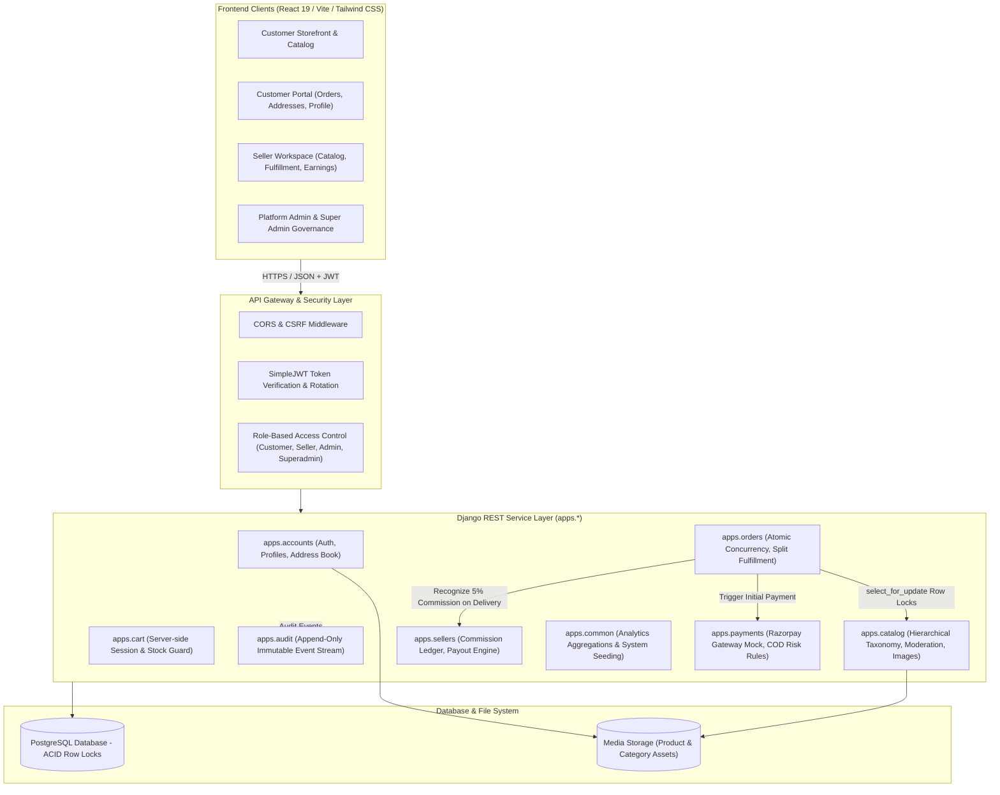

# GALLA. — Full-Stack Multi-Vendor E-Commerce Platform

**GALLA** is a production-grade, multi-vendor e-commerce marketplace and order fulfillment platform engineered with a decoupled full-stack architecture: a **Django REST Framework (DRF)** backend paired with a high-performance **React 19 (Vite & Tailwind CSS)** single-page application.

Designed for scalable multi-vendor retail, GALLA supports isolated vendor catalogs, distributed split-order fulfillment, automated commission and payout ledgers, risk-gated payment pipelines, and an immutable regulatory audit trail.

---

## Table of Contents

1. [Architecture Overview](#1-architecture-overview)
2. [Tech Stack & Tooling](#2-tech-stack--tooling)
3. [User Portals & Features](#3-user-portals--features)
4. [Important Engineering Decisions](#4-important-engineering-decisions)
5. [Directory Structure](#5-directory-structure)
6. [API Route Index](#6-api-route-index)
7. [Environment Configuration](#7-environment-configuration)
8. [Quick Start & Local Setup](#8-quick-start--local-setup)
9. [Running Tests & Quality Assurance](#9-running-tests--quality-assurance)
10. [Audit & Financial Ledger Specifications](#10-audit--financial-ledger-specifications)
11. [Module Documentation References](#11-module-documentation-references)

---

## 1. Architecture Overview

GALLA enforces a clean separation of concerns between client presentations, API orchestration, domain business services, and persistent relational data:



### Key Architectural Layers:

1. **Frontend Presentation**: Single Page Application (SPA) built on React 19, Vite, and Tailwind CSS. Employs TanStack Query v5 for server-state caching, optimistic updates, and declarative cache invalidation.
2. **API & Authentication Gateway**: DRF JSON endpoints authenticated via `djangorestframework_simplejwt`. Features automatic token refreshing, sliding sessions, and granular permission classes.
3. **Domain Service Layer**: Pure Python domain services (`services.py`) encapsulating database transactions, row-level locking, financial calculations (`ROUND_HALF_UP`), and side-effect telemetry.
4. **Data Access & Storage**: PostgreSQL relational database with UUID primary keys, check constraints, conditional unique indexes, and foreign key protections (`PROTECT`).

---

## 2. Tech Stack & Tooling

### Backend

- **Framework**: Python 3.12, Django 5.x / 6.x, Django REST Framework (DRF)
- **Authentication**: `djangorestframework-simplejwt` (HMAC-SHA256 JWTs with token rotation)
- **Database**: PostgreSQL with transactional isolation (`@transaction.atomic`, `select_for_update()`)
- **Image Processing**: `Pillow` (multi-image product galleries, category icons, customer avatars)
- **Filtering & Search**: `django-filter` (hierarchical recursive category filters, price bounds, sorting)
- **CORS & Security**: `django-cors-headers`, secure HTTP headers, media root protection

### Frontend

- **Framework & Runtime**: React 19, Vite 8, Node.js
- **Styling & Layout**: Tailwind CSS 4, Base UI primitives, Lucide React icons
- **State & Server Synchronization**: TanStack React Query v5 (stale-while-revalidate, optimistic mutations, window-focus re-fetching)
- **Client Routing**: React Router v7 with declarative route guards (`ProtectedRoute`, `RoleRoute`)
- **HTTP Client**: Axios with automatic JWT bearer injection and interceptor-based 401 token refresh retry queue
- **State Store**: Zustand (lightweight auth session and token persistence)

---

## 3. User Portals & Features

The platform is divided into four dedicated, role-guarded portal ecosystems:

### A. Customer Storefront & Portal

- **Catalog Browsing**: Real-time keyword search, price range filtering, sort by price/newest, and department taxonomy.
- **Hierarchical Categories**: Interactive primary category carousel with dynamic image/icon rendering, plus secondary subcategory pills (`Clothing > Shirts`, `Home & Kitchen > Cookware`).
- **Product Details Showcase**: Multi-thumbnail interactive image gallery, stock indicators, artisan credentials, 7-day guarantee details, and **Dynamic Recommended Products**.
- **Shopping Cart**: Real-time server-synced cart with item-level quantity increments, out-of-stock validation, and subtotal recalculation.
- **Multi-Step Checkout**:
  - Saved shipping address selector with instant address addition.
  - Risk-gated payment selection: **Cash on Delivery (COD)** vs. **Razorpay Online Payment**.
- **Razorpay Simulator Modal**: Authentic gateway simulation styled with 256-bit encryption badges, lock indicators, and atomic status transitions. Closing the modal preserves the order in a safe `pending` state with instant completion recovery.
- **Customer Dashboard**: Live order tracking with itemized status badges, delivery snapshots, one-click item cancellations with automatic stock restocking, and saved address book management.

### B. Multi-Vendor Seller Workspace

- **Vendor Onboarding**: Customers can submit merchant applications with business credentials, tax details, and store descriptions for admin review.
- **Seller Executive Dashboard**: Metric KPI cards tracking gross merchandise volume (GMV), net earnings, active listings, and incoming order counts.
- **Product Management Workbench**: Create, update, and manage product listings. Multi-image gallery uploader with primary thumbnail selection. Products undergo moderation (`under_review` $\to$ `approved`).
- **Split-Order Fulfillment**: Sellers only see and fulfill items from orders belonging to their store. Independent status workflow: `confirmed` $\to$ `processing` $\to$ `shipped` $\to$ `delivered`.
- **Financial Earnings Ledger**: Detailed itemized record of delivered items showing gross price, platform fee (5% commission), and net payout accrual.
- **Payout History**: Complete log of bank disbursements with transaction references and payout dates.

### C. Platform Administration Portal

- **Executive Analytics Dashboard**: Platform-wide metrics including Total GMV, Net Platform Commission Retained, Total Orders, Active Merchants, and Customer count.
- **Seller Application Moderation**: Approve or reject vendor applications with custom administrative feedback.
- **Catalog Quality Control**: Product review queue to inspect, approve, or reject seller product submissions prior to storefront listing.
- **Category Taxonomy Manager**:
  - Create and edit parent and child subcategories.
  - Upload custom category images/icons (PNG, SVG, WebP, JPG) with real-time previews.
  - Dynamic nesting dropdown with cycle prevention.
- **Platform Orders & Fulfillment Inspection**: Full visibility into multi-vendor split orders with vendor-item breakdowns.
- **Payments & COD Reconciliation**: Transaction ledger for online payments and physical cash collection confirmation for COD deliveries.
- **Seller Payout Generation**: Issue payouts to verified sellers with balance validation and reference tracking.

### D. Super Admin Governance

- **Immutable Audit Trail (`/admin/audit-logs`)**: Real-time visual inspector for all critical platform events (logins, order creations, cancellations, status transitions, product reviews, payouts).
- **Actor & IP Traceability**: Tracks user identity, role, client IP address, user-agent, and exact before/after state diffs.

---

## 4. Important Engineering Decisions

### 1. Concurrency Control & Row-Level Locking

- **Problem**: In high-traffic sales, concurrent checkouts for low-stock inventory can cause overselling and negative inventory.
- **Decision**: In `apps.orders.services.create_order`, product rows are sorted by ID and locked inside an ACID transaction using `select_for_update()`.
- **Result**: Inventory validation and decrement operations are serialized per product, preventing race conditions, deadlocks, and phantom reads.

### 2. Distributed Split-Order Fulfillment Architecture

- **Problem**: In a multi-vendor marketplace, a single customer order may contain products from multiple independent sellers with distinct warehouses and delivery timelines.
- **Decision**: A master `Order` decomposes into multiple `OrderItem` records, each assigned to a specific `seller`.
- **Result**: Sellers can only inspect and transition their own items (`confirmed` $\to$ `processing` $\to$ `shipped` $\to$ `delivered`). The parent `Order.status` is computed dynamically via an aggregation service (e.g. if one item is `shipped` and another `processing`, the parent order transitions to `partially_shipped`; when all items reach `delivered`, the master order transitions to `delivered`).

### 3. Dual-Enforced Risk-Gated Payment Policy (COD vs. Online)

- **Problem**: Cash on Delivery for high-value orders carries high logistics risk, return-to-origin (RTO) expenses, and courier fraud.
- **Decision**: Enforced strict threshold rule:
  - **Orders $\le$ ₹1,500**: Eligible for either Cash on Delivery (COD) or Online Payment (Razorpay).
  - **Orders $>$ ₹1,500**: Cash on Delivery is strictly forbidden; Online Payment (Razorpay) is required.
- **Defense in Depth**:
  - _Frontend_: `PaymentMethodSelector.jsx` disables the COD selector, displays an advisory banner, and automatically selects Razorpay.
  - _Backend_: `apps.orders.services.create_order` validates `total_amount > MAX_COD_ORDER_AMOUNT (Decimal("1500.00"))` and raises a `ValidationError` if COD is attempted.

### 4. Cartesian-Safe Financial Aggregations

- **Problem**: Joining multiple one-to-many relationships (e.g., `SellerProfile` $\to$ `SellerEarning` and `SellerProfile` $\to$ `SellerPayout`) in a single SQL query produces a Cartesian product, multiplying financial sums by the number of matching records in the joined table.
- **Decision**: In `apps.sellers.services.get_admin_seller_earnings_queryset`, independent subqueries are used with `OuterRef("pk")` and `Coalesce`:
  ```python
  earnings_subquery = SellerEarning.objects.filter(seller=OuterRef("pk")).values("seller").annotate(total=Sum("net_amount")).values("total")
  payouts_subquery = SellerPayout.objects.filter(seller=OuterRef("pk")).values("seller").annotate(total=Sum("amount")).values("total")
  ```
- **Result**: Aggregate calculations for gross sales, platform fees, net earnings, and available balances remain mathematically precise with zero Cartesian row multiplication.

### 5. Resilient Payment Gateway Simulation

- **Problem**: In test environments, closing a payment modal or navigating away often results in undefined states or accidental order placement.
- **Decision**:
  - Orders placed with online payment remain in `Payment.Status.PENDING`.
  - Closing the `RazorpaySimulatorModal` keeps the user on `/checkout`, provides a persistent recovery banner, and preserves the pending order.
  - Sellers are blocked from fulfilling items until payment status is confirmed `SUCCESSFUL`.

### 6. Dynamic Recursive Taxonomy & Asset Fallbacks

- **Problem**: Hardcoding category icons in frontend components prevents new categories from displaying appropriate icons.
- **Decision**:
  - Added `image` field to `Category` model with admin upload support.
  - `ProductFilter` in `apps.catalog.filters` recursively resolves all descendant subcategories when filtering by a parent category slug.
  - `CategoryCard.jsx` on the frontend uses uploaded images with `object-contain` scaling, fail-safe `onError` listeners, and semantic vector fallbacks (including `Trophy` for Sports/Fitness).

### 7. Append-Only Model-Level Audit Immutability

- **Problem**: Privileged administrative accounts or compromised services could alter or delete audit history to conceal unauthorized operations.
- **Decision**: Overrode `save()` and `delete()` methods on `AuditEvent` model:

  ```python
  def save(self, *args, **kwargs):
      if self.pk:
          raise ValidationError("Audit events are immutable and cannot be updated.")
      super().save(*args, **kwargs)

  def delete(self, *args, **kwargs):
      raise ValidationError("Audit events cannot be deleted.")
  ```

- **Result**: Guarantees an immutable, tamper-evident audit trail for regulatory compliance.

---

## 5. Directory Structure

```
GALLA./
├── apps/                        # Modular Django backend applications
│   ├── accounts/                # Custom User, CustomerProfile, Address, JWT Auth
│   ├── audit/                   # Append-only AuditEvent engine and telemetry
│   ├── cart/                    # Server-side Cart & CartItem management
│   ├── catalog/                 # Category (nested), Product, ProductImage, moderation
│   ├── common/                  # RBAC permissions, Admin dashboard analytics, Seeder
│   ├── orders/                  # Concurrency checkout, Split Order & OrderItem engine
│   ├── payments/                # Razorpay simulation, PaymentAttempt ledger, COD confirm
│   └── sellers/                 # SellerProfile, Applications, Commission & Payout ledger
├── config/                      # Project settings & URL routing
│   ├── settings/
│   │   ├── base.py              # Core shared settings, JWT lifetimes, apps, middleware
│   │   ├── development.py       # Local development settings & CORS
│   │   └── production.py        # Production security, static assets, database pooling
│   ├── asgi.py
│   ├── urls.py                  # Root URL routing table
│   └── wsgi.py
├── frontend/                    # Modern React 19 + Vite frontend application
│   ├── public/                  # Public assets & favicons
│   ├── src/
│   │   ├── components/          # Reusable UI primitives (Dialog, Button, Badge, Navbar)
│   │   ├── context/             # React Context providers (AuthProvider, ThemeProvider)
│   │   ├── features/            # Domain-driven feature modules
│   │   │   ├── admin/           # Platform metrics, seller moderation, taxonomy, payouts
│   │   │   ├── audit/           # Super Admin audit log visualizer & diff viewer
│   │   │   ├── auth/            # Login, Registration, JWT storage, role verification
│   │   │   ├── cart/            # Interactive shopping cart drawer and page
│   │   │   ├── checkout/        # Address book, Payment selector, Razorpay modal
│   │   │   ├── customer/        # Customer orders, cancellations, profile, address book
│   │   │   ├── seller/          # Seller portal, product CRUD, fulfillment, earnings
│   │   │   └── storefront/      # Catalog, filters, product details, recommendations
│   │   ├── layouts/             # Root, Storefront, Auth, Customer, Seller, Admin layouts
│   │   ├── lib/                 # Axios client, QueryClient, constants, utilities
│   │   ├── routes/              # Declarative React Router setup with RoleRoute guards
│   │   └── stores/              # Zustand global client stores
│   ├── package.json
│   └── vite.config.js
├── manage.py
├── requirements.txt
└── README.md
```

---

## 6. API Route Index

### Authentication & Accounts (`/api/auth/` & `/api/accounts/`)

| Method            | Path                                         | Access        | Description                            |
| :---------------- | :------------------------------------------- | :------------ | :------------------------------------- |
| `POST`            | `/api/auth/register/`                        | Public        | Register customer account              |
| `POST`            | `/api/auth/login/`                           | Public        | Obtain JWT `access` & `refresh` tokens |
| `POST`            | `/api/auth/token/refresh/`                   | Public        | Refresh expired access token           |
| `GET`             | `/api/auth/me/`                              | Authenticated | Retrieve current user profile and role |
| `GET`/`PUT`       | `/api/accounts/profile/`                     | Authenticated | Read/update profile details            |
| `POST`            | `/api/accounts/profile/image/`               | Authenticated | Upload customer avatar image           |
| `GET`/`POST`      | `/api/accounts/addresses/`                   | Customer      | List or create shipping addresses      |
| `GET`/`PUT`/`DEL` | `/api/accounts/addresses/<id>/`              | Customer      | Manage specific delivery address       |
| `GET`             | `/api/accounts/admin/customers/`             | Admin         | List all registered customers          |
| `PATCH`           | `/api/accounts/admin/customers/<id>/status/` | Admin         | Activate/deactivate customer account   |

### Catalog & Taxonomy (`/api/catalog/`)

| Method            | Path                                          | Access         | Description                                                                    |
| :---------------- | :-------------------------------------------- | :------------- | :----------------------------------------------------------------------------- |
| `GET`             | `/api/catalog/categories/`                    | Public         | List root categories with nested subcategories (pass `?flat=true` for all)     |
| `POST`            | `/api/catalog/categories/`                    | Admin          | Create category with optional parent and image upload                          |
| `GET`/`PUT`/`DEL` | `/api/catalog/categories/<slug>/`             | Public / Admin | Retrieve, update (with image), or delete category                              |
| `GET`             | `/api/catalog/products/`                      | Public         | List approved products (supports recursive `category`, `search`, price bounds) |
| `GET`             | `/api/catalog/products/<slug>/`               | Public         | View product details with images and seller info                               |
| `GET`/`POST`      | `/api/catalog/seller/products/`               | Seller         | List seller listings or create product for review                              |
| `GET`/`PUT`/`DEL` | `/api/catalog/seller/products/<slug>/`        | Seller         | Manage seller product listing                                                  |
| `POST`/`DEL`      | `/api/catalog/seller/products/<slug>/images/` | Seller         | Upload or delete product gallery images                                        |
| `GET`             | `/api/catalog/admin/products/`                | Admin          | List all products across moderation states                                     |
| `POST`            | `/api/catalog/admin/products/<slug>/review/`  | Admin          | Approve or reject product submission                                           |

### Shopping Cart (`/api/cart/`)

| Method        | Path                    | Access   | Description                                |
| :------------ | :---------------------- | :------- | :----------------------------------------- |
| `GET`         | `/api/cart/`            | Customer | Retrieve active cart with stock validation |
| `POST`        | `/api/cart/items/`      | Customer | Add product to cart with inventory check   |
| `PATCH`/`DEL` | `/api/cart/items/<id>/` | Customer | Update quantity or remove cart item        |

### Orders & Split Fulfillment (`/api/orders/`)

| Method  | Path                                             | Access   | Description                                                                               |
| :------ | :----------------------------------------------- | :------- | :---------------------------------------------------------------------------------------- |
| `POST`  | `/api/orders/checkout/`                          | Customer | Atomic checkout with `select_for_update` and COD $\le$ ₹1,500 check                       |
| `GET`   | `/api/orders/`                                   | Customer | List customer order history                                                               |
| `GET`   | `/api/orders/<id>/`                              | Customer | Order details with itemized seller statuses                                               |
| `POST`  | `/api/orders/<order_id>/items/<item_id>/cancel/` | Customer | Cancel pending item and restore inventory                                                 |
| `GET`   | `/api/orders/seller/`                            | Seller   | List incoming order items for authenticated seller                                        |
| `GET`   | `/api/orders/seller/<id>/`                       | Seller   | View seller fulfillment details                                                           |
| `PATCH` | `/api/orders/seller/<id>/status/`                | Seller   | Transition item status (`confirmed` $\to$ `processing` $\to$ `shipped` $\to$ `delivered`) |
| `GET`   | `/api/orders/admin/`                             | Admin    | List all platform orders                                                                  |
| `GET`   | `/api/orders/admin/<id>/`                        | Admin    | Deep inspection of split order items                                                      |

### Payments & Financial Transactions (`/api/payments/`)

| Method | Path                                    | Access   | Description                                              |
| :----- | :-------------------------------------- | :------- | :------------------------------------------------------- |
| `GET`  | `/api/payments/`                        | Customer | List customer payments                                   |
| `GET`  | `/api/payments/<id>/`                   | Customer | Payment record with attempt details                      |
| `POST` | `/api/payments/<id>/mock-process/`      | Customer | Simulate gateway authorization (`successful` / `failed`) |
| `GET`  | `/api/payments/admin/`                  | Admin    | List all platform payments                               |
| `POST` | `/api/payments/admin/<id>/confirm-cod/` | Admin    | Confirm cash collection for COD order                    |

### Sellers, Commissions & Payouts (`/api/sellers/`)

| Method      | Path                                           | Access   | Description                                               |
| :---------- | :--------------------------------------------- | :------- | :-------------------------------------------------------- |
| `POST`      | `/api/sellers/applications/`                   | Customer | Submit merchant onboarding application                    |
| `GET`       | `/api/sellers/admin/applications/`             | Admin    | List seller onboarding applications                       |
| `POST`      | `/api/sellers/admin/applications/<id>/review/` | Admin    | Approve or reject merchant application                    |
| `GET`/`PUT` | `/api/sellers/profile/`                        | Seller   | View/update vendor profile and bank info                  |
| `GET`       | `/api/sellers/earnings/dashboard/`             | Seller   | Seller KPI summary: gross sales, commission, net earnings |
| `GET`       | `/api/sellers/earnings/`                       | Seller   | Itemized earnings ledger from delivered items             |
| `GET`       | `/api/sellers/payouts/`                        | Seller   | History of disbursed payouts                              |
| `GET`       | `/api/sellers/admin/earnings/`                 | Admin    | Platform-wide seller balances (Cartesian-safe)            |
| `POST`      | `/api/sellers/admin/sellers/<id>/payouts/`     | Admin    | Record verified seller payout against available balance   |

### Audit & Operations (`/api/audit/` & `/api/admin/`)

| Method | Path                    | Access     | Description                                               |
| :----- | :---------------------- | :--------- | :-------------------------------------------------------- |
| `GET`  | `/api/audit/`           | Superadmin | Read-only access to immutable audit log stream            |
| `GET`  | `/api/admin/dashboard/` | Admin      | Platform executive dashboard metrics (GMV, orders, users) |

---

## 7. Environment Configuration

### Backend Configuration (`.env` in root)

```env
DEBUG=True
SECRET_KEY=your-secure-django-secret-key-here
ALLOWED_HOSTS=localhost,127.0.0.1

# Database Configuration (PostgreSQL)
DB_NAME=galla_db
DB_USER=galla_user
DB_PASSWORD=galla_password
DB_HOST=localhost
DB_PORT=5432

# CORS Configuration
CORS_ALLOWED_ORIGINS=http://localhost:5173,http://127.0.0.1:5173
```

### Frontend Configuration (`frontend/.env`)

```env
VITE_API_BASE_URL=http://localhost:8000/api
```

---

## 8. Quick Start & Local Setup

### Prerequisites

- Python 3.12+
- Node.js 20+ and npm
- PostgreSQL 15+

### Backend Setup

1. **Create and activate a virtual environment**:
   ```bash
   python3 -m venv .venv
   source .venv/bin/activate
   ```
2. **Install dependencies**:
   ```bash
   pip install -r requirements.txt
   ```
3. **Execute database migrations**:
   ```bash
   python manage.py migrate
   ```
4. **Seed demo data (Categories, Products, Users, Orders, Payouts)**:
   ```bash
   python manage.py seed_demo_data
   ```
5. **Start the Django development server**:
   ```bash
   python manage.py runserver 0.0.0.0:8000
   ```

### Frontend Setup

1. **Navigate to the frontend directory**:
   ```bash
   cd frontend
   ```
2. **Install npm dependencies**:
   ```bash
   npm install
   ```
3. **Start the Vite development server**:
   ```bash
   npm run dev
   ```
4. Open [http://localhost:5173](http://localhost:5173) in your browser.

---

## 9. Running Tests & Quality Assurance

### Backend Automated Test Suite

Run the full test suite across all 8 apps (160+ automated test cases):

```bash
python manage.py test
```

To run tests for specific modules:

```bash
# Catalog & recursive filters
python manage.py test apps.catalog

# Orders & concurrency checkout
python manage.py test apps.orders

# Payments & COD risk rules
python manage.py test apps.payments

# Sellers & payout ledger
python manage.py test apps.sellers
```

### Frontend Linting & Production Build

Validate code style, dependencies, and bundle compilation:

```bash
cd frontend

# Run ESLint validation
npm run lint

# Compile production bundle
npm run build
```

---

## 10. Audit & Financial Ledger Specifications

### Marketplace Commission Calculation

- Applied when an `OrderItem` transitions to `DELIVERED` and associated payment is `SUCCESSFUL`.
- **Commission Rate**: Fixed 5% (`COMMISSION_RATE = Decimal("0.0500")`).
- **Rounding Policy**: Quantized to 2 decimal places using `ROUND_HALF_UP`:
  $$\text{Commission} = (\text{Item Subtotal} \times 0.05).\text{quantize}(\text{Decimal}("0.01"), \text{ROUND\_HALF\_UP})$$
  $$\text{Net Earning} = \text{Item Subtotal} - \text{Commission}$$
- `SellerEarning` records are created idempotently via `get_or_create` with a `OneToOneField` on `OrderItem`.

### Payout Balance Invariant

For any given seller at any time:
$$\text{Pending Payout Balance} = \sum \text{Net Earnings} - \sum \text{Completed Payouts}$$
Administrative payouts lock the `SellerProfile` row with `select_for_update()`, preventing concurrent overdraft payouts.

---

## 11. Module Documentation References

For in-depth domain specifications, schema diagrams, and endpoint contracts, refer to the individual module documents:

- [Accounts Module Documentation](apps/accounts/doc.txt)
- [Sellers Module Documentation](apps/sellers/doc.txt)
- [Catalog Module Documentation](apps/catalog/doc.txt)
- [Cart Module Documentation](apps/cart/doc.txt)
- [Orders Module Documentation](apps/orders/doc.txt)
- [Payments Module Documentation](apps/payments/doc.txt)
- [Audit Module Documentation](apps/audit/doc.txt)
- [Common Module Documentation](apps/common/doc.txt)
