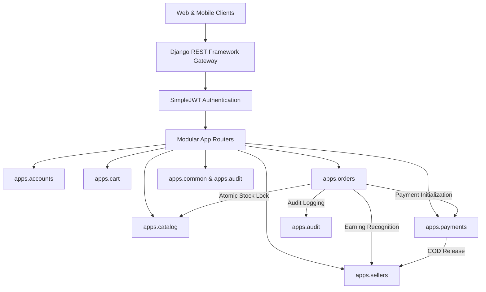

# 1. GALLA — Multi-Vendor E-Commerce Marketplace Backend

GALLA is a multi-vendor e-commerce marketplace and order management backend built with Python, Django, and Django REST Framework, tailored for multi-vendor retail operations in Kerala and Indian commercial contexts.

---

## Table of Contents
1. [Title & High-level Description](#1-galla--multi-vendor-e-commerce-marketplace-backend)
2. [Architecture Overview](#2-architecture-overview)
3. [Domain Model Summary](#3-domain-model-summary)
4. [User Roles & Capabilities](#4-user-roles--capabilities)
5. [Authentication & Authorization](#5-authentication--authorization)
6. [Key End-to-End Workflows](#6-key-end-to-end-workflows)
7. [Directory Structure](#7-directory-structure)
8. [Tech Stack & Dependencies](#8-tech-stack--dependencies)
9. [Environment Configuration](#9-environment-configuration)
10. [Quick Start & Local Setup](#10-quick-start--local-setup)
11. [Database Migrations](#11-database-migrations)
12. [Running Tests](#12-running-tests)
13. [API Route Index](#13-api-route-index)
14. [Accounts Module Reference](#14-accounts-module-reference)
15. [Sellers Module Reference](#15-sellers-module-reference)
16. [Catalog Module Reference](#16-catalog-module-reference)
17. [Cart Module Reference](#17-cart-module-reference)
18. [Orders Module Reference](#18-orders-module-reference)
19. [Payments Module Reference](#19-payments-module-reference)
20. [Audit Module Reference](#20-audit-module-reference)
21. [Common Module Reference](#21-common-module-reference)
22. [Admin Dashboard & Operations](#22-admin-dashboard--operations)
23. [Code Quality & Standards](#23-code-quality--standards)
24. [Known Limitations & MVP Scope Boundaries](#24-known-limitations--mvp-scope-boundaries)
25. [Links to Module Documentation](#25-links-to-module-documentation)

---

## 2. Architecture Overview
GALLA follows a modular Django application architecture with a clean separation of concerns:
- **Presentation Layer**: Django REST Framework APIViews, Generics, and Mixins providing JSON REST interfaces.
- **Service Layer**: Dedicated service modules (`services.py`) encapsulating complex domain workflows, atomic transactions, row-level locks, and side-effect orchestration.
- **Data Access Layer**: Django ORM models with strict constraints (UUID primary keys, conditional unique constraints, protected foreign keys, and custom querysets). Note that UUIDs provide non-sequential identifiers; access control and object isolation are enforced by permissions and query scoping.
- **Security & Telemetry**: Model-level audit logging layer capturing state transitions with automatic sensitive data filtering.



---

## 3. Domain Model Summary
- **User** (`accounts.User`): UUID-based custom user model authenticated via email. Supports roles `customer`, `seller`, `admin`, `superadmin`.
- **CustomerProfile** (`accounts.CustomerProfile`): 1:1 with customer user; stores phone number and avatar.
- **Address** (`accounts.Address`): Shipping address book with conditional unique constraint for default address per user.
- **SellerApplication** (`sellers.SellerApplication`): Vendor application records submitted by customers, reviewed by admins.
- **SellerProfile** (`sellers.SellerProfile`): Active/suspended vendor store identity created upon application approval.
- **SellerEarning** (`sellers.SellerEarning`): 1:1 with delivered `OrderItem`; holds gross subtotal, fixed 5% commission, and net earning.
- **SellerPayout** (`sellers.SellerPayout`): Completed manual bank payout ledger entries with unique transaction reference.
- **Category** (`catalog.Category`): Self-referencing hierarchical category tree with unique slugs and protected deletion.
- **Product** (`catalog.Product`): Seller-owned catalog items with SKU (unique per seller), price, stock, and moderation state (`pending`, `approved`, `rejected`).
- **ProductImage** (`catalog.ProductImage`): Gallery images with conditional unique constraint guaranteeing at most one primary image per product.
- **Cart & CartItem** (`cart.Cart`, `cart.CartItem`): Server-side shopping cart with unique product-per-cart constraint.
- **Order & OrderItem** (`orders.Order`, `orders.OrderItem`): Master customer order and itemized seller-specific order items with immutable address and price snapshots.
- **Payment & PaymentAttempt** (`payments.Payment`, `payments.PaymentAttempt`): Order payment tracking with multi-attempt ledger. Statuses: `pending`, `successful`, `failed`, `refunded`, `cancelled`.
- **AuditEvent** (`audit.AuditEvent`): Application-level append-only event stream tracking actor, entity, action (21 choices), metadata, and client IP/agent. Protected against modification and deletion by model instance methods (`save()` and `delete()`), with QuerySet bulk operations (`.update()`, `.delete()`) and direct raw SQL bypassing model hooks.

---

## 4. User Roles & Capabilities
| Role | Capabilities | Restrictions |
| :--- | :--- | :--- |
| **Customer** | Register, login, manage profile & addresses, browse catalog, manage cart, place orders, cancel pending items, simulate mock online payments | Cannot access seller, admin, or superadmin endpoints |
| **Seller** | Submit seller application, manage store profile, create products & upload images, manage own order items, view earnings & payouts | Cannot approve own products, access other sellers' orders, or record payouts |
| **Admin** | Passes `IsPlatformAdmin` to review seller applications, moderate products, update seller/customer statuses, confirm COD collections, record payouts, inspect platform orders/payments, and view the analytics dashboard (`GET /api/admin/dashboard/`) | Cannot access the audit event query endpoint (`GET /api/audit/`) |
| **Superadmin** | Holds role `superadmin`. Has all `IsPlatformAdmin` permissions plus exclusive access to the audit event query API (`IsSuperAdmin` on `GET /api/audit/`). When staff/superuser flags are enabled, accesses Django Admin (`/admin/`) to manage registered models (`User`, `Group`, `Category`, `Product`, `ProductImage`, `Payment`, `PaymentAttempt`, `AuditEvent`) | Scoped to registered models, views, and defined API endpoints; does not provide arbitrary operational bypass outside configured views and models |

---

## 5. Authentication & Authorization
- **Token Mechanism**: JSON Web Tokens via `djangorestframework_simplejwt`.
- **Token Lifetimes** (configured in `config/settings/base.py`):
  * Access Token: **30 minutes**
  * Refresh Token: **7 days**
- **Header**: `Authorization: Bearer <access_token>`.
- **Key Custom Permissions**:
  - `IsPlatformAdmin`: Ensures user is authenticated and has role `admin` or `superadmin`.
  - `IsActiveSeller`: Ensures user is authenticated, has role `seller`, and holds an active `SellerProfile`.
  - `IsCustomer`: Ensures user is authenticated and has role `customer`.
  - `IsSuperAdmin`: Ensures user is authenticated and has role `superadmin`.

---

## 6. Key End-to-End Workflows

### 6.1 Customer Shopping & Checkout
1. Customer registers via `POST /api/auth/register/` and logs in via `POST /api/auth/login/`.
2. Customer browses approved products via `GET /api/catalog/products/`.
3. Customer adds products to cart via `POST /api/cart/items/`.
4. Customer executes checkout via `POST /api/orders/checkout/` specifying shipping address and payment method (`cod` or `razorpay`). Stock is locked with `select_for_update()` and deducted atomically.
5. If `razorpay`, customer pays via mock endpoint `POST /api/payments/<payment_id>/mock-process/`.

### 6.2 Seller Onboarding & Product Catalog
1. Customer submits vendor application via `POST /api/sellers/applications/`.
2. Platform Admin reviews application via `PATCH /api/sellers/admin/applications/<id>/review/`.
3. On approval, user role transitions to `SELLER`, and `SellerProfile` is created.
4. Seller submits a new product via `POST /api/catalog/seller/products/`. Product status is initially `PENDING`.
5. Seller uploads gallery photos via `POST /api/catalog/seller/products/<slug>/images/`.
6. Admin approves product via `PATCH /api/catalog/admin/products/<slug>/review/`. Product becomes publicly visible.

### 6.3 Order Fulfillment & Multi-Seller Splitting
1. Customer places order containing items from multiple sellers.
2. Order splits into discrete `OrderItem` records tagged with each respective seller profile.
3. Sellers fulfill items independently through status progression:
   `PENDING` $\to$ `CONFIRMED` $\to$ `PROCESSING` $\to$ `SHIPPED` $\to$ `DELIVERED`.
4. Online payment gate ensures sellers cannot advance items beyond `PENDING` unless online payment is `SUCCESSFUL`.
5. Parent order status automatically reaggregates (`PARTIALLY_SHIPPED`, `DELIVERED`, etc.).

### 6.4 Payment Processing: Online Mock vs. COD
- **Online (Razorpay)**: Customer triggers mock processing via `POST /api/payments/<id>/mock-process/`, creating a `PaymentAttempt`. Once marked `SUCCESSFUL`, seller fulfillment is unlocked. Upon item reaching `DELIVERED`, seller earnings are recognized immediately.
- **Cash on Delivery (COD)**: Sellers can fulfill and deliver immediately. Earnings are recognized once Platform Admin confirms physical collection via `POST /api/payments/admin/<id>/confirm-cod/`. Note that COD confirmation updates payment state directly and does not create a `PaymentAttempt`.

### 6.5 Seller Earnings & Payouts
1. 5% commission (`COMMISSION_RATE = Decimal("0.0500")`) is calculated on the individual delivered product subtotal (`order_item.subtotal`), excluding delivery charges and taxes, rounded to 2 decimal places using `ROUND_HALF_UP`.
2. Earning record (`SellerEarning`) is created with a strict 1:1 relationship to the delivered order item.
3. Available balance is calculated: `Total Net Earnings - Total Recorded Payouts`.
4. Platform Admin executes bank transfer offline and records the payout via `POST /api/sellers/admin/sellers/<id>/payouts/` with row locking and duplicate reference protection.

---

## 7. Directory Structure
```
GALLA/
├── apps/
│   ├── accounts/          # User identity, JWT auth, profiles, addresses, doc.txt
│   ├── audit/             # Immutable audit event telemetry & service, doc.txt
│   ├── cart/              # Persistent user carts and cart items, doc.txt
│   ├── catalog/           # Categories, products, images, and public views, doc.txt
│   ├── common/            # RBAC permissions, admin dashboard stats, doc.txt
│   ├── orders/            # Checkout, order items, fulfillment, cancellation, doc.txt
│   ├── payments/          # Payment tracking, mock gateway, COD confirmation, doc.txt
│   └── sellers/           # Onboarding, profiles, earnings, and payouts, doc.txt
├── config/
│   ├── settings/
│   │   ├── base.py        # Core Django settings & third-party configs
│   │   ├── development.py # Local development settings
│   │   └── production.py  # Production configuration template
│   ├── asgi.py
│   ├── urls.py            # Global routing index
│   └── wsgi.py
├── media/                 # Uploaded media (profile pictures, product images)
├── manage.py              # Django CLI utility
├── MVP_AUDIT.md           # Comprehensive technical audit report
├── README.md              # Project documentation index
└── requirements.txt       # Exact pinned dependencies
```

---

## 8. Tech Stack & Dependencies
- **Runtime**: Python 3.14.10
- **Web Framework**: Django 6.1.3
- **API Framework**: Django REST Framework 3.18.3
- **Authentication**: djangorestframework-simplejwt 5.5.1 / PyJWT 2.15.1
- **Database Driver**: psycopg 3.3.8 / psycopg-binary 3.3.8 (PostgreSQL)
- **Image Processing**: Pillow 13.0.0
- **Filtering & CORS**: django-filter 26.2, django-cors-headers 4.9.0
- **Environment**: python-dotenv 1.2.4

---

## 9. Environment Configuration
Create a `.env` file in the root directory:
```env
DEBUG=True
SECRET_KEY=django-insecure-change-this-in-production-key-for-galla-platform
ALLOWED_HOSTS=localhost,127.0.0.1,::1

# Database Configuration (PostgreSQL)
DB_NAME=galla_db
DB_USER=sahal
DB_PASSWORD=
DB_HOST=localhost
DB_PORT=5432

# CORS Configuration
CORS_ALLOWED_ORIGINS=http://localhost:3000,http://127.0.0.1:3000
```

---

## 10. Quick Start & Local Setup
1. **Clone repository and create virtual environment**:
   ```bash
   git clone <repo_url> GALLA
   cd GALLA
   python3 -m venv .venv
   source .venv/bin/activate
   ```
2. **Install dependencies**:
   ```bash
   pip install -r requirements.txt
   ```
3. **Configure PostgreSQL database**:
   ```bash
   createdb galla_db
   ```
4. **Apply migrations**:
   ```bash
   python manage.py migrate
   ```
5. **Create superuser (or use demo seed)**:
   ```bash
   python manage.py createsuperuser
   ```
6. **Seed Demo Marketplace Data (Recommended for Local Dev & Testing)**:
   ```bash
   # Seed realistic interconnected demo data (users, sellers, catalog, Pillow images, orders, payouts)
   python manage.py seed_demo_data

   # Or cleanly purge only demo data and re-seed
   python manage.py seed_demo_data --reset
   ```
   **Predictable Demo Credentials** (password for all demo accounts: `DemoPass@123`):
   | Role | Email | Notes |
   | :--- | :--- | :--- |
   | **Super Admin** | `superadmin@demo.galla.store` | Full platform administration & audit logs access |
   | **Platform Admin** | `admin@demo.galla.store` | Application moderation, COD collection, payouts |
   | **Active Seller 1** | `seller.malabar@demo.galla.store` | Malabar Spice & Craft Co. (Home & Handicrafts) |
   | **Active Seller 2** | `seller.cochin@demo.galla.store` | Cochin Tech & Gadgets (Electronics & Audio) |
   | **Active Seller 3** | `seller.kerala@demo.galla.store` | Kerala Weaves & Apparel (Traditional Fashion) |
   | **Active Seller 4** | `seller.greenvalley@demo.galla.store` | Green Valley Naturals (Ayurvedic & Wellness) |
   | **Suspended Seller** | `seller.coastal@demo.galla.store` | Coastal Electronics (Suspended merchant state) |
   | **Pending Applicant**| `applicant.pending@demo.galla.store` | Apex Home Furnishings (Pending review) |
   | **Rejected Applicant**| `applicant.rejected@demo.galla.store`| Fly-by-Night Imports (Rejected application) |
   | **Sample Customer** | `customer.rahul.nair@demo.galla.store` | Active customer with default address & order history |
   | **Sample Customer** | `customer.ananya.menon@demo.galla.store`| Active customer with multi-vendor orders |

7. **Start development server**:
   ```bash
   python manage.py runserver
   ```

---

## 11. Database Migrations
- Check migration state:
  ```bash
  python manage.py showmigrations
  ```
- Dry run check:
  ```bash
  python manage.py makemigrations --check --dry-run
  ```
- Apply pending migrations:
  ```bash
  python manage.py migrate
  ```

---

## 12. Running Tests
The suite contains 416 automated tests covering unit, API, integration, and concurrency scenarios.
- Run entire test suite:
  ```bash
  python manage.py test
  ```
- Run tests for a specific app:
  ```bash
  python manage.py test apps.sellers
  python manage.py test apps.orders
  ```
- Run concurrency tests:
  ```bash
  python manage.py test apps.sellers.tests.test_earnings_and_payouts.ConcurrentPayoutTests
  ```

---

## 13. API Route Index

### Authentication & Accounts (`/api/auth/` and `/api/accounts/`)
| Method | Path | Auth / Role | Description |
| :--- | :--- | :--- | :--- |
| `POST` | `/api/auth/register/` | Public | Customer account registration |
| `POST` | `/api/auth/login/` | Public | Obtain SimpleJWT access & refresh tokens |
| `POST` | `/api/auth/token/refresh/` | Public | Refresh JWT access token |
| `GET` | `/api/auth/me/` | Authenticated | Get current authenticated user details |
| `GET, PUT, PATCH` | `/api/auth/profile/` | Authenticated | Manage customer profile information |
| `PATCH` | `/api/auth/profile/image/` | Authenticated | Upload customer profile avatar |
| `GET, POST` | `/api/auth/addresses/` | Authenticated | List and create customer shipping addresses |
| `GET, PUT, PATCH, DELETE` | `/api/auth/addresses/<uuid:pk>/` | Authenticated | Manage single customer shipping address |
| `GET` | `/api/auth/admin/customers/` | Platform Admin | List and search all customer accounts |
| `GET` | `/api/auth/admin/customers/<uuid:pk>/` | Platform Admin | View detailed customer account info |
| `PATCH` | `/api/auth/admin/customers/<uuid:pk>/status/` | Platform Admin | Activate or deactivate customer account |

### Sellers (`/api/sellers/`)
| Method | Path | Auth / Role | Description |
| :--- | :--- | :--- | :--- |
| `POST` | `/api/sellers/applications/` | Authenticated | Submit vendor onboarding application |
| `GET` | `/api/sellers/admin/applications/` | Platform Admin | List & filter vendor applications |
| `PATCH` | `/api/sellers/admin/applications/<uuid:pk>/review/` | Platform Admin | Approve or reject vendor application |
| `GET` | `/api/sellers/admin/sellers/` | Platform Admin | List all registered seller profiles |
| `GET` | `/api/sellers/admin/sellers/<uuid:pk>/` | Platform Admin | Inspect specific seller profile details |
| `PATCH` | `/api/sellers/admin/sellers/<uuid:pk>/status/` | Platform Admin | Suspend or reactivate seller account |
| `GET` | `/api/sellers/admin/earnings/` | Platform Admin | Platform-wide seller financial summary |
| `GET` | `/api/sellers/admin/sellers/<uuid:pk>/earnings/` | Platform Admin | Itemized earnings for specific seller |
| `GET, POST` | `/api/sellers/admin/sellers/<uuid:pk>/payouts/` | Platform Admin | View and record completed seller payouts |
| `GET, PATCH` | `/api/sellers/profile/` | Active Seller | Manage own vendor store profile |
| `GET` | `/api/sellers/earnings/dashboard/` | Active Seller | View real-time financial balance dashboard |
| `GET` | `/api/sellers/earnings/` | Active Seller | List own itemized earnings history |
| `GET` | `/api/sellers/payouts/` | Active Seller | List own payout transaction history |

### Catalog (`/api/catalog/`)
| Method | Path | Auth / Role | Description |
| :--- | :--- | :--- | :--- |
| `GET` | `/api/catalog/categories/` | Public | List active category hierarchy |
| `POST` | `/api/catalog/categories/` | Platform Admin | Create product category |
| `GET` | `/api/catalog/categories/<slug>/` | Public | Retrieve single category details |
| `PUT, PATCH, DELETE` | `/api/catalog/categories/<slug>/` | Platform Admin | Manage or soft-delete category |
| `GET` | `/api/catalog/products/` | Public | Browse approved products from active sellers |
| `GET` | `/api/catalog/products/<slug>/` | Public | Retrieve detailed product information |
| `GET, POST` | `/api/catalog/seller/products/` | Active Seller | List own products or create new listing |
| `GET, PUT, PATCH` | `/api/catalog/seller/products/<slug>/` | Active Seller | Retrieve or edit own product |
| `GET` | `/api/catalog/admin/products/` | Platform Admin | List all products across moderation states |
| `PATCH` | `/api/catalog/admin/products/<slug>/review/` | Platform Admin | Approve or reject product listing |
| `GET, POST` | `/api/catalog/seller/products/<slug>/images/` | Active Seller | Manage product photo gallery |
| `GET, DELETE` | `/api/catalog/seller/products/<slug>/images/<uuid:pk>/` | Active Seller | Retrieve or delete specific gallery photo |

### Cart (`/api/cart/`)
| Method | Path | Auth / Role | Description |
| :--- | :--- | :--- | :--- |
| `GET` | `/api/cart/` | Customer | Retrieve customer shopping cart |
| `POST` | `/api/cart/items/` | Customer | Add item to cart with stock validation |
| `PATCH, DELETE` | `/api/cart/items/<uuid:pk>/` | Customer | Update quantity or remove cart item |

### Orders (`/api/orders/`)
| Method | Path | Auth / Role | Description |
| :--- | :--- | :--- | :--- |
| `POST` | `/api/orders/checkout/` | Customer | Convert cart to order with atomic stock deduction |
| `GET` | `/api/orders/` | Customer | List customer order history |
| `GET` | `/api/orders/<uuid:pk>/` | Customer | Retrieve customer order details |
| `POST` | `/api/orders/<uuid:order_id>/items/<uuid:item_id>/cancel/` | Customer | Cancel pending order item with inventory restore |
| `GET` | `/api/orders/seller/` | Active Seller | List incoming order items for authenticated seller |
| `GET` | `/api/orders/seller/<uuid:pk>/` | Active Seller | View order item fulfillment details |
| `PATCH` | `/api/orders/seller/<uuid:pk>/status/` | Active Seller | Advance item fulfillment status |
| `GET` | `/api/orders/admin/` | Platform Admin | List and filter all platform orders |
| `GET` | `/api/orders/admin/<uuid:pk>/` | Platform Admin | Administrative order deep inspection |

### Payments (`/api/payments/`)
| Method | Path | Auth / Role | Description |
| :--- | :--- | :--- | :--- |
| `GET` | `/api/payments/` | Customer | View customer payment history |
| `GET` | `/api/payments/<uuid:pk>/` | Customer | View payment record and attempt traces |
| `POST` | `/api/payments/<uuid:pk>/mock-process/` | Customer | Process mock online payment (outcome: successful/failed) |
| `GET` | `/api/payments/admin/` | Platform Admin | List all platform payments |
| `GET` | `/api/payments/admin/<uuid:pk>/` | Platform Admin | Administrative view of payment details |
| `POST` | `/api/payments/admin/<uuid:pk>/confirm-cod/` | Platform Admin | Confirm physical cash collection for COD order |

### Audit & Operations (`/api/audit/` and `/api/admin/`)
| Method | Path | Auth / Role | Description |
| :--- | :--- | :--- | :--- |
| `GET` | `/api/audit/` | Superadmin | Query application-level append-only audit event stream |
| `GET` | `/api/admin/dashboard/` | Platform Admin | Executive real-time marketplace metrics |

---

## 14. Accounts Module Reference
Detailed documentation: [apps/accounts/doc.txt](apps/accounts/doc.txt)
Provides custom email-based authentication, user role hierarchies, user profiles, address books, and administrative customer controls.

## 15. Sellers Module Reference
Detailed documentation: [apps/sellers/doc.txt](apps/sellers/doc.txt)
Manages vendor onboarding applications, store profiles, 5% commission earnings tracking, and race-safe administrative manual payout recording.

## 16. Catalog Module Reference
Detailed documentation: [apps/catalog/doc.txt](apps/catalog/doc.txt)
Handles hierarchical categories, seller product listings, multi-photo galleries, administrative moderation workflows, and public catalog visibility controls.

## 17. Cart Module Reference
Detailed documentation: [apps/cart/doc.txt](apps/cart/doc.txt)
Implements server-side shopping carts with real-time stock validation, duplicate rejection, and multi-vendor product coexistence.

## 18. Orders Module Reference
Detailed documentation: [apps/orders/doc.txt](apps/orders/doc.txt)
Orchestrates atomic inventory checkout, immutable snapshotting, multi-vendor fulfillment state machines, customer cancellations, and status aggregation.

## 19. Payments Module Reference
Detailed documentation: [apps/payments/doc.txt](apps/payments/doc.txt)
Tracks order payments, mock gateway executions, payment attempt ledgers, and administrative COD cash collection confirmation.

## 20. Audit Module Reference
Detailed documentation: [apps/audit/doc.txt](apps/audit/doc.txt)
Provides an application-level append-only audit event repository protected by model instance methods (with QuerySet and raw SQL limitations documented), sensitive field sanitization, and superadmin telemetry queries.

## 21. Common Module Reference
Detailed documentation: [apps/common/doc.txt](apps/common/doc.txt)
Supplies global RBAC permissions (`IsPlatformAdmin`, `IsActiveSeller`), executive dashboard analytics, custom Django Admin portal styling, and the modular demo database seeder (`python manage.py seed_demo_data`).

---

## 22. Admin Dashboard & Operations
- **Django Admin Portal**: Accessible at `/admin/`, styled via `GallaAdminSite` with custom headers and registered models.
- **REST Analytics Endpoint**: `GET /api/admin/dashboard/` returns live metrics for customers, sellers, catalog, orders, and payment volumes.

---

## 23. Code Quality & Standards
- Modular application boundaries separating domain models, serializers, views, and services.
- Structured DRF serializers handling input validation and serialization.
- Explicit exception handling mapping domain errors to appropriate HTTP status codes (400, 401, 403, 404).
- Database-level integrity constraints (CheckConstraints, UniqueConstraints, PROTECT on foreign keys).

---

## 24. Known Limitations & MVP Scope Boundaries
The following features are intentionally out of scope for the MVP:
1. Live Razorpay payment gateway integration (mock process endpoint is active).
2. Automated bank payout rails (e.g. Razorpay Route / Stripe Connect).
3. Seller digital wallets and complex balance transfers.
4. Real-time courier/shipping carrier API integration.
5. Automated returns and refunds lifecycle (RMA).
6. Multi-tier or category-specific commission rates (fixed 5% commission applied).
7. External email/SMS notification dispatchers (console email backend configured).

---

## 25. Links to Module Documentation
- [Accounts Module Documentation](apps/accounts/doc.txt)
- [Sellers Module Documentation](apps/sellers/doc.txt)
- [Catalog Module Documentation](apps/catalog/doc.txt)
- [Cart Module Documentation](apps/cart/doc.txt)
- [Orders Module Documentation](apps/orders/doc.txt)
- [Payments Module Documentation](apps/payments/doc.txt)
- [Audit Module Documentation](apps/audit/doc.txt)
- [Common Module Documentation](apps/common/doc.txt)
